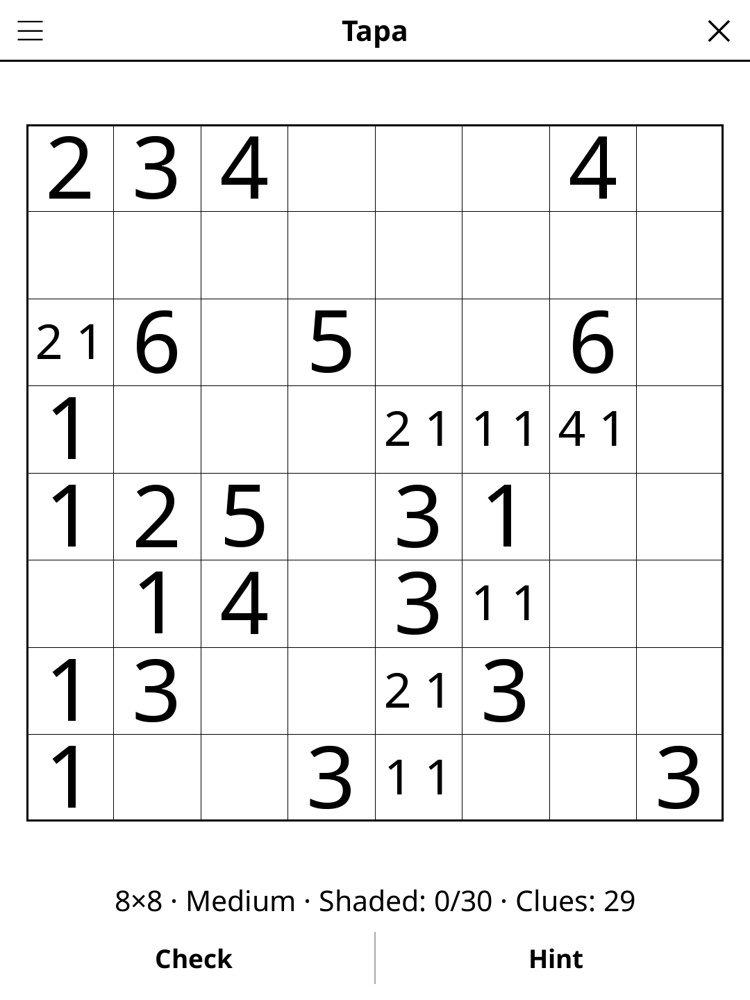

# tapa.koplugin

A Tapa puzzle plugin for [KOReader](https://github.com/koreader/koreader).

## Screenshot

## Rules

Shade cells black to form a single connected group. Numbered clue cells (never shaded) describe the consecutive shaded runs in their 8 surrounding cells. The shaded region must be fully connected. No 2×2 block may be entirely shaded.

## Features

- **Three grid sizes** — 6×6, 8×8 and 10×10
- **Three difficulty levels, no guessing** — every puzzle is solved by
  deduction alone, which also proves its solution unique:
  - *Easy* — about 60% of the possible clues; each clue on its own, the
    2×2 rule and the wall's next cell are enough.
  - *Medium* — fewer clues; once, you need to look at the whole wall (an
    area it cannot reach stays empty, a cell every path goes through is
    shaded).
  - *Hard* — as few clues, and that whole-wall reasoning two or more times.
- **Check** — marks the cells that differ from the solution
- **Hint** — two taps: the first says which cell is about to give, the second acts on it. A cell that contradicts the solution is always reported before a fresh one is revealed
- **Auto-save** — puzzle state saved and restored on next launch

## Installation

1. Download `tapa.koplugin.zip` from the [latest release](../../releases/latest).
2. Extract into the `plugins/` folder of your KOReader data directory.
3. Restart KOReader.
4. Open the menu → **Tools** → **Tapa**.

## Controls

| Action | How |
|--------|-----|
| Shade a cell | Tap it |
| Unshade a cell | Tap it again |
| Check progress | Tap **Check** |
| New puzzle | Tap **New game** |
| Show rules | Tap **Rules** |

## License

GPL-3.0 — see [LICENSE](LICENSE).
